# pak-law-assistant

<!-- mcp-name: io.github.hammasbuilds/pak-law-assistant -->

Question answering and citation checking over Pakistani federal statutes that will not cite a provision that was not
in force on the date asked about. We built it for lawyers, law students, legal-tech developers and AI assistants
that need statute text they can rely on: every provision carries the dates it was in force, every question is
answered *as of a date*, and when the corpus cannot support an answer it refuses and says why. It runs as a local
web page, a Python library and an MCP server, with zero dependencies, over our dataset of the whole federal statute
book (30,174 provisions from 970 Acts).

**Dataset:** [Pakistan Federal Statute Book, Dated by Provision](https://www.kaggle.com/datasets/muhammadhammas13/pakistan-federal-statute-book) on Kaggle.

## What it does

- **Answers as of a date.** "What is the punishment under section 20 PECA?" asked about 2018 and about 2026 gets the
  text in force on each date. Superseded text is kept, not deleted, so questions about past conduct are answered
  against the law as it then stood.
- **Refuses rather than guesses**, in nine named ways (below), each returned as a `refusal_status` token as well as
  prose.
- **Reads citations the way Pakistani lawyers write them**: `Section 302 PPC`, `s. 302 of the Pakistan Penal Code`,
  `sec 302, P.P.C.`, `§302 PPC`, `302-B`, `u/s 302`, `sections 302/34 PPC`, `Order XXXIX Rule 1 CPC`, SROs, PLD and
  SCMR reports, and Urdu or Roman Urdu forms (`دفعہ 302 تعزیرات پاکستان`, `dafa 302 PPC`). `Rs. 500` is not
  section 500.
- **Checks every citation in a draft** against the law on its date: `in_force`, `amended_since`, `not_in_force`,
  `not_yet_in_force`, `unknown_provision`, `no_act_named`, `act_not_recognised` (usually another country's Act),
  `statute_not_loaded`, `not_checkable` or `before_record`, with a verdict that says `all_in_force` only when every
  citation was actually checked.
- **Gives amendment history and word-level diffs** between the text on two dates.
- **Retrieves with BM25**, not embeddings: legal terms of art must match, and "these terms matched with these
  weights" is an explanation a lawyer can check. Section numbers are kept as tokens and boosted, a match must cover
  more than half of the question's content words, and term proximity separates provisions that cover it equally.
- **Validates the corpus before serving**: overlapping versions, gaps and more than one live version are refused at
  load, so an answer never depends on iteration order.
- **Builds corpora** from an Act's official text (`paklaw-corpus`), and `scripts/build_corpus.py` rebuilds the whole
  statute book from the Pakistan Code.

### Nine refusal conditions

| | What it prevents | `refusal_status` |
|---|---|---|
| No provision found | A plausible-sounding answer with no citation | `nothing_matched` |
| **Provision not in force** | An authoritative-looking answer about repealed law | `not_in_force` |
| Weak match | The nearest provision returned as though it were relevant | `weak_match` |
| Cited provision unknown | Answering about a *different* section because it scored well | `unknown_provision` |
| No Act named | "section 9" of what? Guessing could answer about the wrong law | `no_act_named` |
| **Act not recognised** | "Section 302 of the Indian Penal Code" certified as Pakistani law | `act_not_recognised` |
| **Different offence** | Answering "attempt to murder" with the murder provision | `different_offence` |
| **Subject not in corpus** | Answering "dacoity with murder" from the nearest provision when the corpus holds nothing on dacoity | `subject_not_in_corpus` |
| **Citation unreliable** | Citing s.57 for a rule that is really s.65, because the source's contents list stopped before its body did | `citation_unreliable` |

Every refusal carries `refusal_status` as well as prose, so a client can branch on the kind without matching on
wording.

## Screenshots

The local web page (`run.bat`, or `paklaw-web`) over the full statute book.

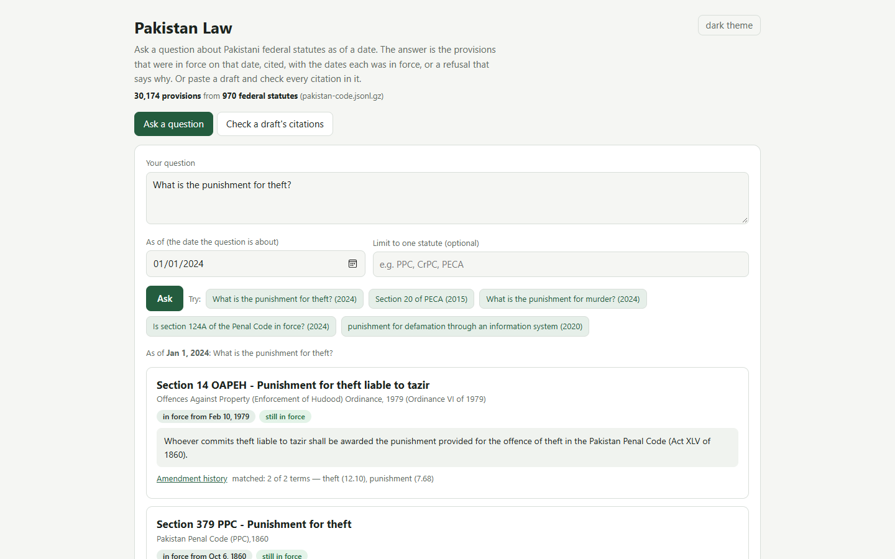
*Input: "What is the punishment for theft?" as of 1 January 2024. Output: section 14 of the Offences Against Property
(Enforcement of Hudood) Ordinance 1979 and section 379 PPC, each with its Act, the date it came into force, "still in
force", the statute text and the terms that matched.*

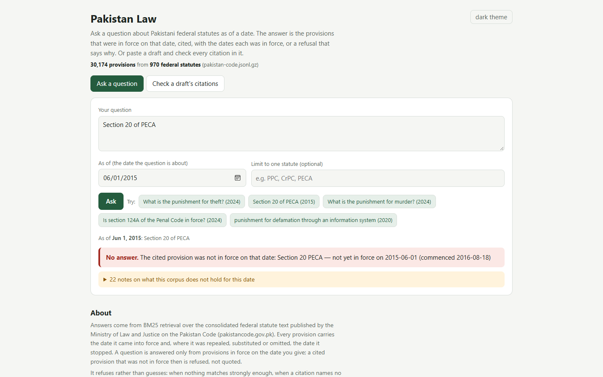
*Input: "Section 20 of PECA" as of 1 June 2015. Output: refused, because section 20 PECA was not yet in force on that
date (it commenced on 18 August 2016); the notes on statutes this corpus does not record that far back are folded.*

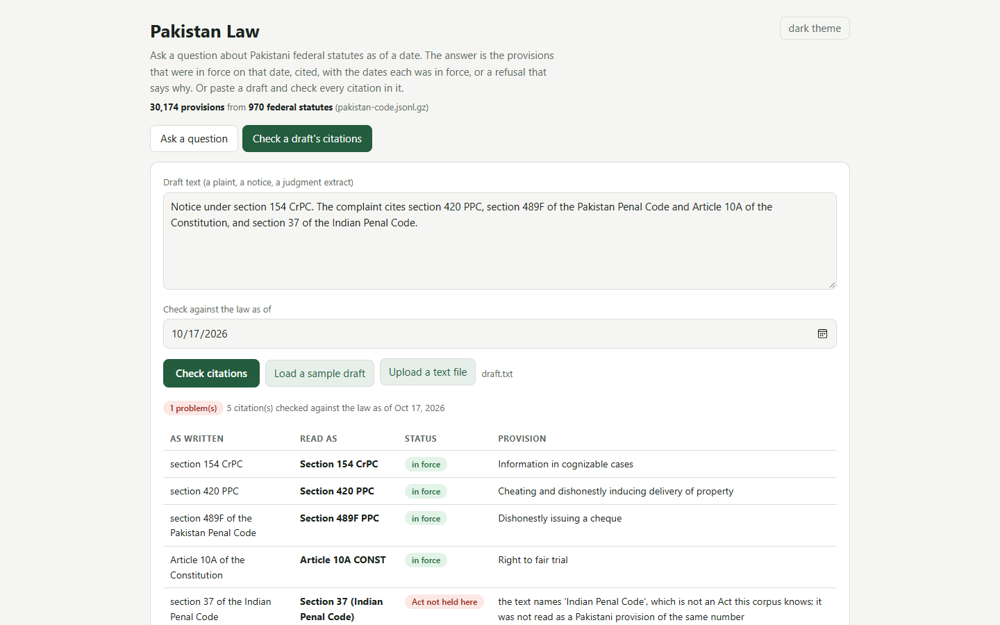
*Input: an uploaded notice citing section 154 CrPC, sections 420 and 489F PPC, Article 10A of the Constitution and
section 37 of the Indian Penal Code. Output: four citations in force with their headings, and the Indian Penal Code
citation flagged "Act not held here" rather than read as a Pakistani section.*

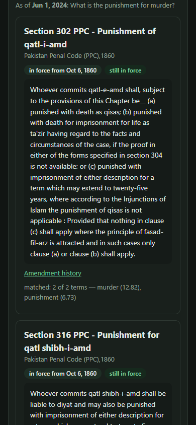
*"What is the punishment for murder?" as of 1 June 2024, limited to the PPC, at 390 px in the dark theme: section 302
PPC with its dates and text.*

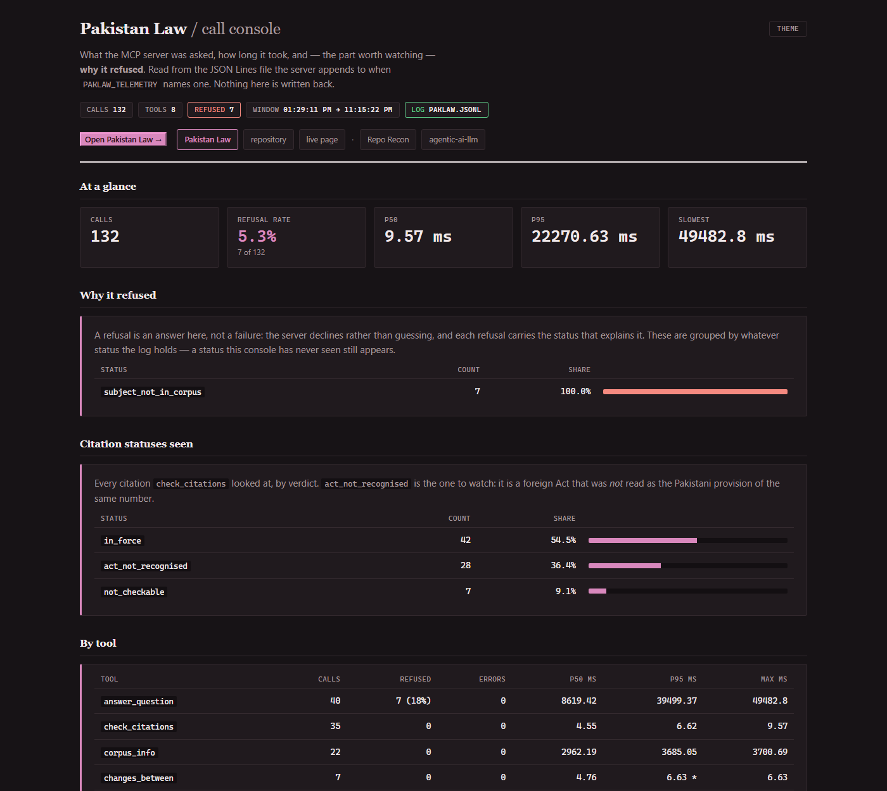
*Every tool call the server answered: which tool, how long it took, and whether it
refused. Never the question - a legal question is the one thing a log of this server
must not keep.*

### Every tool, driven end to end

[`docs/demo/pak-law-assistant-demo.mp4`](docs/demo/pak-law-assistant-demo.mp4) - a minute
in the browser, over the full statute book: the three prepared scenarios, a draft checked
as at a date, and all eight tools called by hand. The screenshots below are frames of
that run.

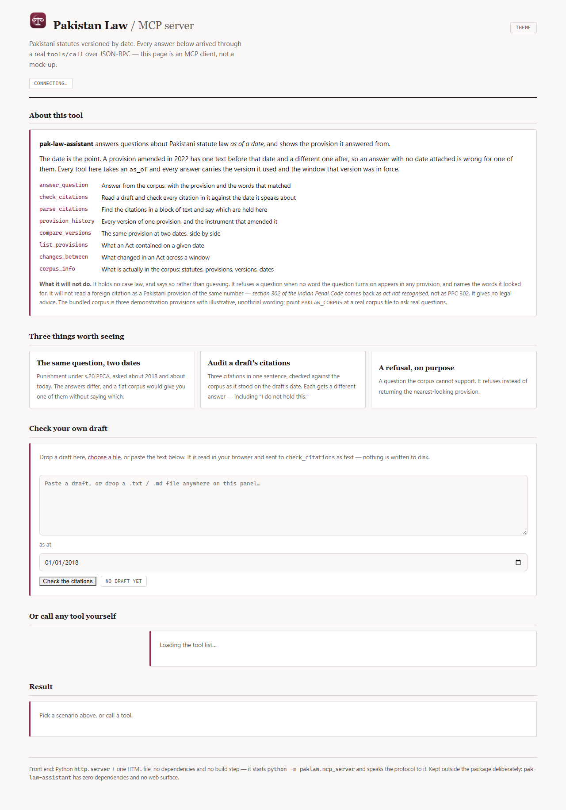
*What each of the eight tools answers, the five things it refuses to do, and which corpus
is loaded - 30,174 provisions across 970 Acts.*

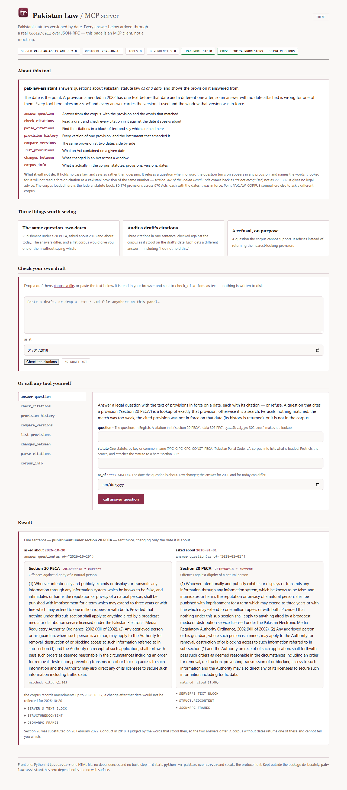
*One sentence sent twice, changing only the date it is asked about. The answers differ,
and a corpus with no dates would hand you one of them without saying which.*

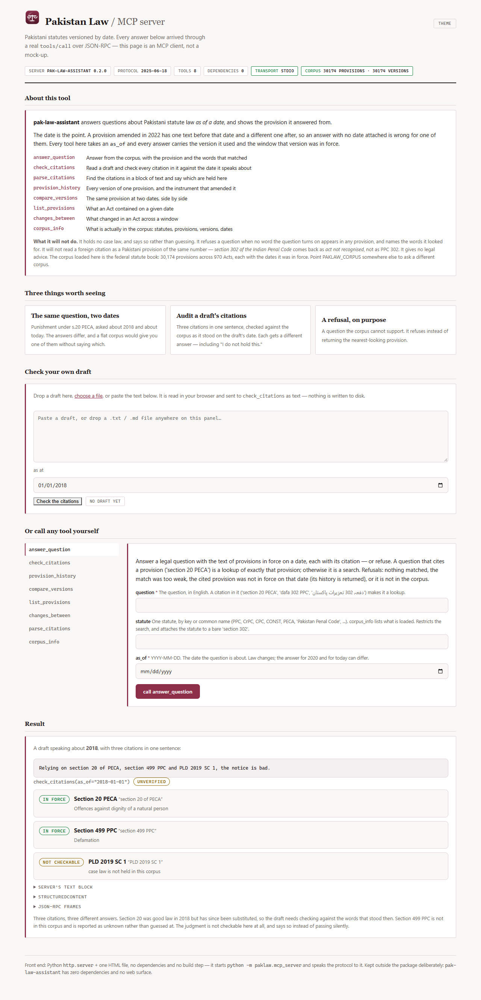
*Three citations in one sentence, checked against the corpus as it stood on the draft's
date - each gets a different answer, including "I do not hold this."*

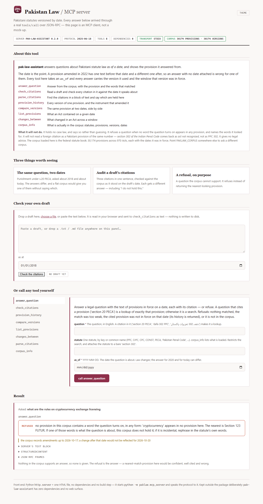
*A question the corpus cannot support. It names the words it looked for and refuses,
rather than returning the nearest-looking provision.*

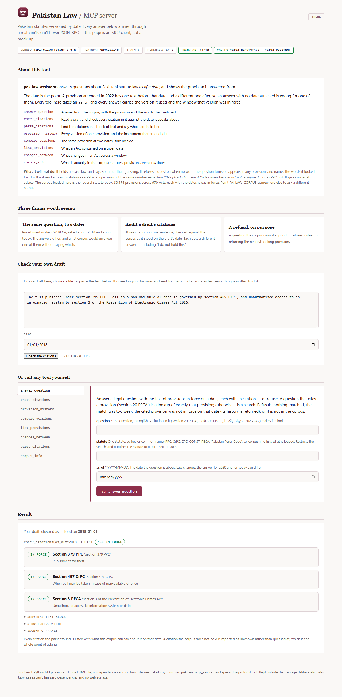
*Input: a paragraph citing s.379 PPC, s.497 CrPC and s.3 PECA, as at 1 January 2018.
Output: each citation with its heading and whether it was in force on that date.*

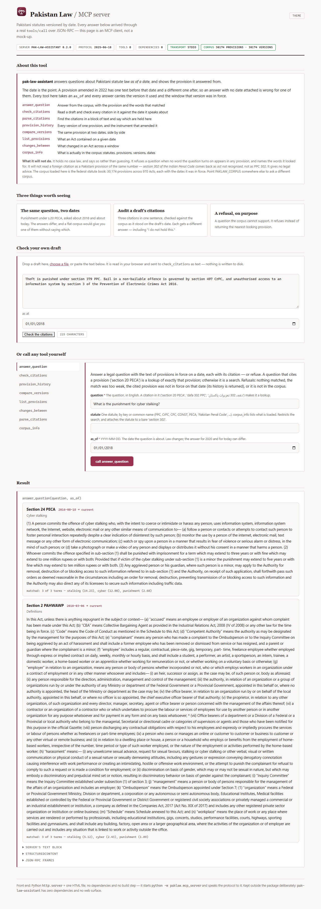
*Input: "What is the punishment for cyber stalking?" as of 2018-01-01. Output: section 24
PECA with its text, the window it has been in force, and the terms that matched.*

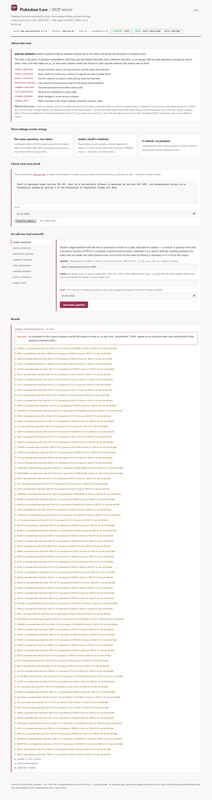
*The same tool, the same question about theft, asked as of 1850. Refused - and the
refusal says which words it searched for and which statutes this corpus does not record
that far back.*

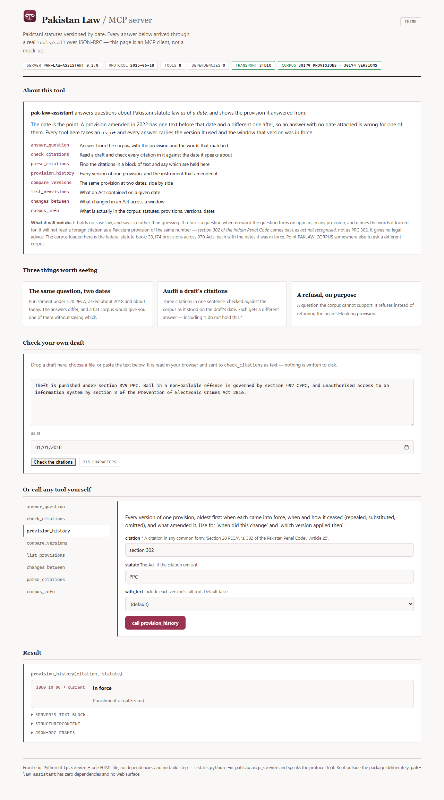
*Every version of section 302 PPC, with the date it came into force and the instrument
that amended it.*

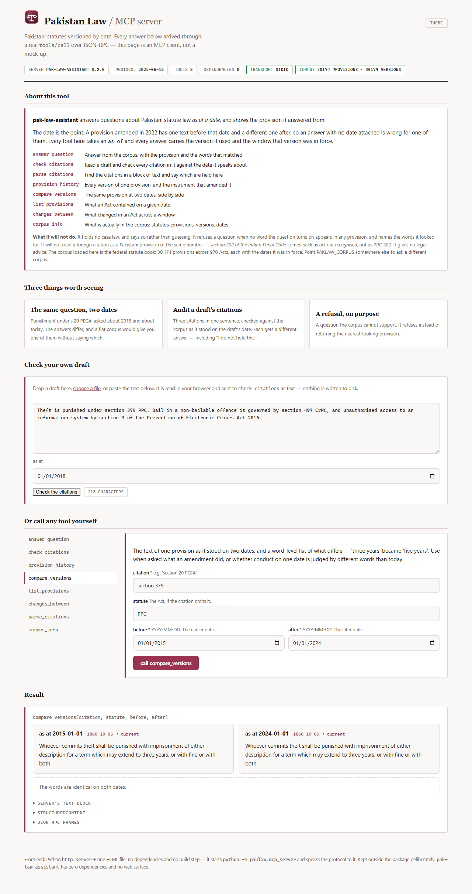
*Section 379 PPC at 2015-01-01 and at 2024-01-01, side by side.*

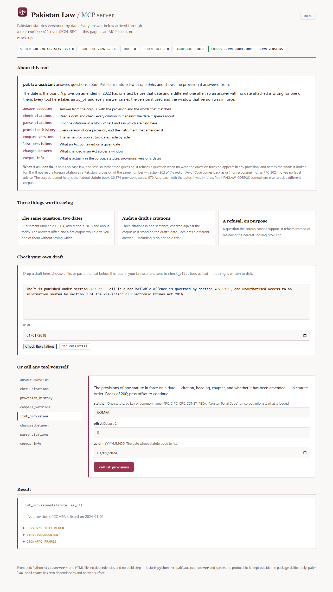
*What the Companies Ordinance 1984 contained on 1 January 2024: nothing. All 524
provisions are held, and none of them was in force on that date.*


*The same Ordinance across 1984-2024, as events with their dates.*

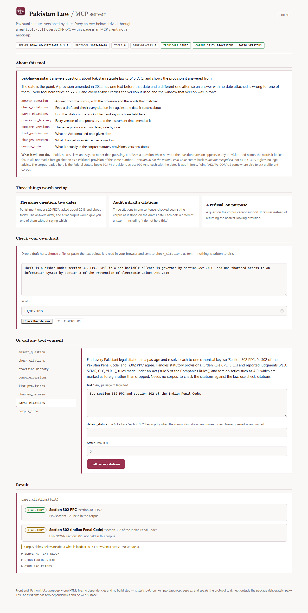
*Input: a sentence citing both section 302 PPC and section 302 of the Indian Penal Code.
Output: the first is held here; the second is reported as an Act not recognised, not read
as the Pakistani section of the same number.*

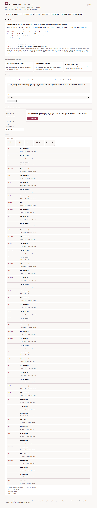
*What is actually loaded: provisions, versions, and the statutes, so a claim about the
corpus can be checked rather than taken.*

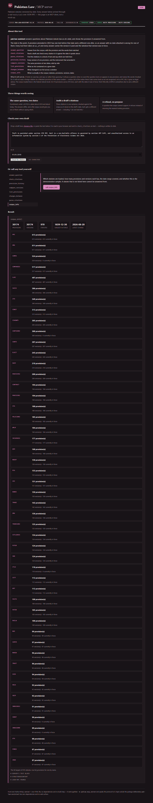
*The same page in the dark theme.*

### How it works, in motion

Every tool in this repository, twice over. A **flow** follows one call from the arguments to the answer and
names what each stage does to it. An **architecture** view shows the four layers of the package with the
modules on them at their real sizes, and lights up the ones that particular tool walks - `corpus_info` reads
the corpus and stops; `check_citations` goes through the citation reader, the Act index and the audit before
it answers. Each is one self-contained HTML file with a poster and a clip beside it - no build step, no
dependencies, no network.

All 19 are in [`docs/isometric/`](docs/isometric/) — [start at the index](docs/isometric/index.html). 10
architecture, 9 flow.

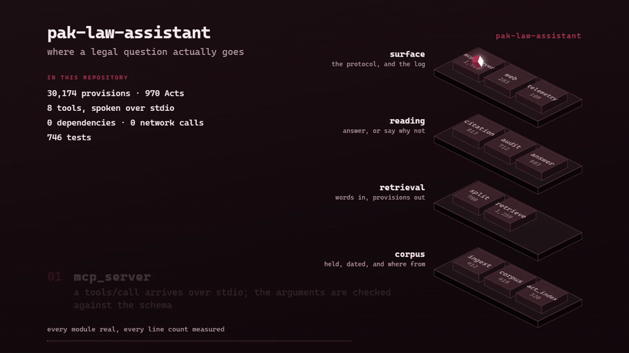
*The four layers, the modules on them at their real sizes, and the path one call takes: `mcp_server` to
`corpus` and `act_index`, down through `split` and `retrieve`, then `citation`, `audit`, `answer`, and the
telemetry line that records the tool but never the question.* · [open the
animation](docs/isometric/scenes/arch-paklaw.html) · [mp4](docs/isometric/scenes/arch-paklaw.mp4)

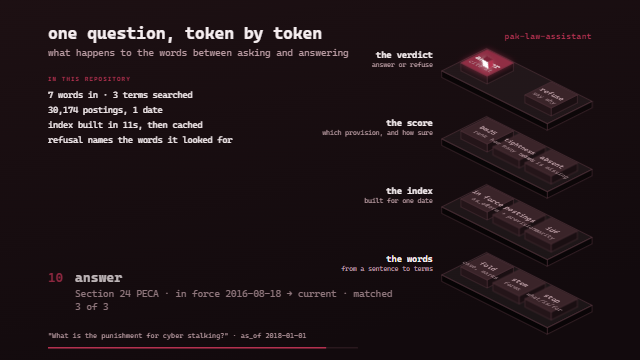
*The same question at the level of its words: folded, stopwords dropped, stemmed, matched against the
postings for one date only, scored - and either cited, or refused with the words it looked for named.* ·
[open the animation](docs/isometric/scenes/arch-paklaw-retrieval.html) ·
[mp4](docs/isometric/scenes/arch-paklaw-retrieval.mp4)

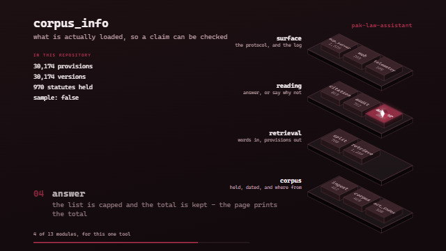
*The same four layers, for the one tool that touches fewest of them: `corpus_info` reads what is loaded and
counts it, and the point of it is that its answer is what every other claim about the corpus can be checked
against.* · [open the animation](docs/isometric/scenes/arch-paklaw-corpus-info.html) ·
[mp4](docs/isometric/scenes/arch-paklaw-corpus-info.mp4)

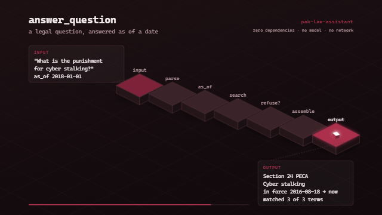
*The flow view of one tool: "What is the punishment for cyber stalking?" as of 1 January 2018 goes in,
section 24 PECA with its in-force window comes out, and the five stages in between each say what they did.*
· [open the animation](docs/isometric/scenes/flow-paklaw-answer-question.html) ·
[mp4](docs/isometric/scenes/flow-paklaw-answer-question.mp4)


## Sample input / output

`python demo.py` runs on a three-provision sample that carries PECA s.20 before and after its 2022 substitution
(also rendered as [input.png](docs/images/input.png) and [output.png](docs/images/output.png)):

```
INPUT
   corpus             3 provisions, 4 versions (PECA s.20 twice: pre- and post-2022)
   as_of 2026-01-01   "What is the penalty for publicly transmitting false inform..."
   as_of 2020-06-01   "What is the penalty for publicly transmitting false inform..."
   as_of 2026-01-01   "What are the registration requirements for a private limit..."

OUTPUT
   [1] asked about 2026-01-01
       Section 20 PECA
       in force   2022-02-20 -> present
       ...shall be punished with imprisonment which may extend to five years or with fine which may extend to ten million rupees or with both.

   [2] the same question, asked about 2020
       Section 20 PECA
       in force   2016-08-19 -> 2022-02-20
       ...shall be punished with imprisonment which may extend to three years or with fine which may extend to one million rupees or with both.

   [3] nothing in the corpus covers this
       REFUSED    no provision in this corpus contains a word the question turns on, in any form: 'company', 'limited', 'private', 'registration', 'requirements' appear in no provision here, and nothing else in the question matched either.
```

The same sentence asked about two dates gets three years and one million rupees, or five years and ten million.

## Results

### The dataset

We built the dataset this runs on: **30,174 provisions from 970 Acts** of the Pakistan Code, 7.7 MB compressed,
each with the dates it was in force and the Act it came from. The Ministry's index lists 1,034 Acts; 3 files are
missing at source, 48 are scanned images with no text layer, 10 yield no provisions, and the rest are here.

| | |
|---|---|
| Commencement read from the Act's own header | 891 of 970 Acts (91.9%) |
| Acts the index records as repealed | 39, their provisions dated and flagged |
| Repeals whose exact day the source does not give | recorded with `end_known: false` |
| Provisions named in an Act's contents but not imported | 0.9% |

### Retrieval quality

```
$ python tests/bench.py

RETRIEVAL QUALITY
======================================================================
  question set                          n   right  wrong  refused
  ----------------------------------------------------------------
  in a person's words                  17      16      0        1
  paraphrases                          34      29      0        5
  written later again                  20      15      0        5
  ----------------------------------------------------------------
  not in corpus (set 1)                 6       0      0        6
  not in corpus (set 2)                10       0      0       10
  not in corpus (set 3)                10       0      0       10
  in corpus, unanswerable               8       0      0        8
  ----------------------------------------------------------------
  105 questions asked: 60 answered correctly, 0 wrong, 34 of 34 correctly refused
```

`wrong` is the column to read: a refusal costs a reader a lookup, a confident citation of the wrong provision costs
them the argument. The three answerable sets were written at three different times over 31 real provisions; the
refusal sets hold 26 subjects the corpus does not hold, plus 8 questions built from the corpus's own words that it
still cannot answer. These are questions written for this repository, so the 0 describes these 105 questions.

Ranking uses **term proximity**, how close together a provision states the words of the question, to separate
provisions that cover it equally well. Two questions about s.57 PPC ("imprisonment for life shall be reckoned as
equivalent to imprisonment for twenty-five years") tied at full coverage with s.302, which contains the same words
in different clauses; the smallest window holding all five words is 6 tokens in s.57 and 21 in s.302. The weight
(0.5) sits in the middle of the plateau a sweep over the 105 questions found. The same change fixed
`"consent of the heirs of the victim"`, which had returned s.55A rather than s.54: the phrase is verbatim in the
provisos of s.54 and s.55 and in the body of s.55A.

The refusals cost recall: that is 11 refusals of 71 answerable questions against no wrong answer. `python tests/bench.py --ablate` removes the rule and prints both sides:

```
                          right  wrong  refused  answered anyway
  as shipped                 60      0       11                0
  rule removed               65      1        5               22
```

`tests/test_clause_population.py` builds a set nobody chose (the first nine words of each provision's first clause):
31 questions, 30 right, 1 wrong, 0 refused.

## Tech stack

- Python 3.10+, standard library only: BM25 retrieval, citation parser, temporal corpus, audit and diff are all in
  `src/paklaw`
- MCP server: the stdio transport implemented directly (newline-delimited JSON-RPC 2.0), eight read-only tools with
  declared `outputSchema`s, no SDK
- Web page: `http.server` (`ThreadingHTTPServer`, 127.0.0.1 only) and one HTML file with vanilla JavaScript, light
  and dark themes, no build step
- Corpus builder: `scripts/build_corpus.py` (Pakistan Code index, PDF text via `pdftotext`) and the `paklaw-corpus`
  CLI
- pytest, ruff and jsonschema (dev only); hatchling for the build; CI on Python 3.10-3.13

## Run it

```bash
git clone https://github.com/hammasbuilds/pak-law-assistant
cd pak-law-assistant
pip install -e .          # no dependencies
python demo.py            # the library, on the bundled sample
python demo_mcp.py        # the same questions through the MCP server
pytest -q                 # needs pytest, ruff and jsonschema: uv sync --all-groups
```

The full statute book is [on Kaggle](https://www.kaggle.com/datasets/muhammadhammas13/pakistan-federal-statute-book).
Save it as `data/pakistan-code.jsonl.gz` (or anywhere, and set `PAKLAW_CORPUS` to its path); without it everything
runs on a three-provision sample with illustrative wording and says so in every result.

### The web page

```bash
paklaw-web                                   # http://127.0.0.1:8841/, opens a browser tab
run.bat --port 8841 --no-browser             # Windows, from the repo folder
paklaw-web --corpus path/to/statutes.jsonl   # another corpus
```

Ask a question with the date it is about (and optionally one statute), or paste or upload a draft to check its
citations. An answer over the full corpus takes a few seconds on a laptop CPU.

### From Python

```python
from paklaw import LawAssistant
from paklaw.mcp_server import load_corpus

corpus, _ = load_corpus("data/pakistan-code.jsonl.gz")
assistant = LawAssistant(corpus=corpus)
print(assistant.answer("What is the punishment for theft?", as_of="2024-01-01").render())
print(assistant.history("section 20 PECA"))
```

### As an MCP server

The same library as eight read-only tools for Claude Desktop, Claude Code or any
[Model Context Protocol](https://modelcontextprotocol.io) client. Every date argument is required, there is no raw
search tool (only `answer_question`, which can refuse), a refusal is a normal result, and a bad argument such as
`as_of="last year"` is a tool error that names the format.

| Tool | Use it for |
|---|---|
| `answer_question` | "what does the law say about X *on this date*": provision text with citations, or one of the nine refusals |
| `check_citations` | auditing a draft (a brief, a notice, or a model's own answer): a status for every citation on the date, plus its character offset |
| `provision_history` | "when did section 20 change?": every version, how each one ended, and the instrument on each side |
| `compare_versions` | "what did the amendment do?": a word-level diff between the text on two dates |
| `list_provisions` | a statute's table of contents on a date, in statute order (2 < 10 < 10A), paged |
| `changes_between` | every commencement, substitution, omission and repeal in a period |
| `parse_citations` | turns `s. 302 of the Pakistan Penal Code`, `§302 PPC` and `sec 302, P.P.C.` into one key; needs no corpus |
| `corpus_info` | what is loaded, so the model knows what it *cannot* answer |

`python demo_mcp.py` starts the server and calls it over stdio:

```
[1] answer_question(as_of='2026-01-01')   -- asked about today
    Section 20 PECA   in force 2022-02-20 -> present
    ...shall be punished with imprisonment which may extend to five years or with fine which may extend to ten million rupees or with both.

[2] answer_question(as_of='2020-06-01')   -- the same, about 2020
    Section 20 PECA   in force 2016-08-19 -> 2022-02-20
    ...shall be punished with imprisonment which may extend to three years or with fine which may extend to one million rupees or with both.

[3] answer_question(as_of='2015-01-01')   -- before enactment
    REFUSED     the cited provision was not in force on that date: Section 20 PECA — not yet in force on 2015-01-01 (commenced 2016-08-19)

[4] provision_history(citation='s. 20 of the Prevention of Electronic Crimes Act')
    2016-08-19 -> 2022-02-20  substituted  Ordinance II of 2022
    2022-02-20 -> present     in force

[5] compare_versions(citation='section 20 PECA', before='2020-01-01', after='2026-01-01')   -- what the amendment changed
    added     'through any information system,'
    replaced  'three' -> 'five'
    replaced  'one' -> 'ten'

[6] check_citations(as_of='2019-03-01')   -- a draft about 2019 conduct
    amended_since     Section 20(1) PECA in force on 2019-03-01, but amended with effect from 2022-02-20 — check the draft quotes the words in force on its date
    in_force          Article 25 CONST
    not_checkable     PLD 2015 SC 401   case law is not held in this corpus
    unknown_provision Section 21 PECA   PECA has no such provision here
    verdict: problems

[7] answer_question(as_of='last year')   -- a date the model got wrong
    TOOL ERROR  as_of must be a date as YYYY-MM-DD, got 'last year'
```

### Connect it

Install it, then point your client at the `paklaw-mcp` command:

```bash
pip install git+https://github.com/hammasbuilds/pak-law-assistant
paklaw-mcp --check                       # prints what the server will serve, then exits
claude mcp add pak-law -e PAKLAW_CORPUS=/path/to/statutes.jsonl -- paklaw-mcp   # Claude Code
```

Claude Desktop does not inherit your shell's `PATH`, so either give it the **full path**
to `paklaw-mcp` (`where paklaw-mcp` on Windows, `which paklaw-mcp` elsewhere), or let
`uvx` fetch and run it without installing anything. In `claude_desktop_config.json`:

```json
{
  "mcpServers": {
    "pak-law": {
      "command": "uvx",
      "args": ["--from", "git+https://github.com/hammasbuilds/pak-law-assistant", "paklaw-mcp"],
      "env": { "PAKLAW_CORPUS": "/path/to/statutes.jsonl" }
    }
  }
}
```

On Windows write the corpus path with forward slashes or doubled backslashes
(`"C:/law/statutes.jsonl"`), since a single backslash is an escape in JSON. Leave
`PAKLAW_CORPUS` out to try the three-provision sample first.

Once the package is on PyPI the same server starts with `uvx pak-law-assistant` (the
package also installs a `pak-law-assistant` command for exactly this), which is how MCP
registry clients run it; `server.json` is its
[MCP Registry](https://registry.modelcontextprotocol.io) manifest.

`server.json` declares `registryType: "pypi"` at the package's current version, which
is what the registry needs and is **not** a statement that the upload has happened. The
order matters: submitted to the registry before the PyPI release, every client that
installs from it fails at `uvx pak-law-assistant`. **Upload to PyPI first, then submit
the manifest.** `test_registry_manifest_matches_the_package` keeps the declared version
equal to `pyproject.toml` and `paklaw.__version__`, so the manifest cannot drift ahead
of the package it names - but nothing in this repository can tell you whether the upload
has been done, which is why the order is written here.

| Setting | |
|---|---|
| `PAKLAW_CORPUS` | path to the corpus file. The only configuration there is |
| network | none; the server never opens a socket or makes an outbound request |
| writes | none; every tool is read-only, and the corpus is changed only by `paklaw-corpus`, never by the model |

### Building a corpus: `paklaw-corpus`

No statute text ships with this repo (the full statute book is on Kaggle). `paklaw-corpus` builds a
corpus from an Act's official text and records amendments. It checks that every
version's dates line up, so a corpus the server would refuse is never written.

```bash
# split an Act's text into provisions ("20. Heading.—(1) Whoever ...")
paklaw-corpus import peca_2016.txt --statute PECA --in-force-from 2016-08-19 -o statutes.jsonl

# record amendments: each one closes the live version and opens the next on the same date
paklaw-corpus substitute statutes.jsonl "section 20 PECA" --on 2022-02-20 \
    --by "Ordinance II of 2022" --text-file s20_amended.txt
paklaw-corpus insert statutes.jsonl "section 26A PECA" --on 2025-01-29 \
    --by "Act I of 2025" --heading "..." --text-file s26a.txt
paklaw-corpus repeal statutes.jsonl "section 3 PECA" --on 2024-01-01 --by "..."

paklaw-corpus check statutes.jsonl      # the same validation the server runs at start
```

The Constitution and the Qanun-e-Shahadat Order are numbered in articles, and `import`
stores them that way (`--unit` overrides it). A corpus that holds either as *sections* is
refused at load, because `Article 6` would then find nothing.

`import` reads plain text by default. For the two public sources, say which one, so page
footers, footnotes and amendment markers are removed before splitting:

```bash
pdftotext -layout ppc.pdf ppc.txt
paklaw-corpus import ppc.txt --source pakistan-code --statute PPC --in-force-from 1860-10-06 -o statutes.jsonl
paklaw-corpus import ppc.html --source pakistani-org --statute PPC --in-force-from 1860-10-06 -o statutes.jsonl
```

A corpus file may start with one header line, `{"_corpus": {"as_at": "2025-06-30", ...}}`,
saying when it was last brought up to date. A provision row with `"start_known": false`
marks the date as where the corpus's *record* of that statute begins, not a commencement.
Answers dated after `as_at`, or before a statute's record begins, carry a warning, and
`check_citations` gives such a citation `before_record` instead of calling it
`not_yet_in_force`.

The importer's traps are the real ones. A numbered line inside a body (`3. Thirty days:
…` in the middle of section 20) is not accepted as a new section, because its number
doesn't follow the previous one; it is kept as body text and listed in the report. An
omitted section (`4. [Omitted by …]`) ends the section before it and is listed for its
dates to be recorded by hand. Chapter headings label the sections under them and are
kept out of the bodies. Amending a *subsection* on its own is refused: the corpus holds
whole provisions, and a separately stored subsection would sit beside the stale section.

Any Act can be loaded, not just the thirteen the citation parser knows by name. A corpus
holding `PRPA` makes `section 5 PRPA` parse, answer and audit like any other.

### Rebuilding the dataset

Three resumable stages; the middle one takes about 40 minutes over the government site, and both fetch stages skip
what is already on disk:

```bash
python scripts/build_corpus.py catalogue   # the index   -> catalogue.json
python scripts/build_corpus.py fetch       # 1,034 Acts  -> pdf/     (433 MB, outside the repo)
python scripts/build_corpus.py build       # pdf/        -> corpus.jsonl
```

`build` writes a report naming every Act it left out and why, and every provision an Act's contents list names that
did not make it.

## Licence

Code: MIT. The statute text is the Pakistan Code as published by the Ministry of Law and Justice, Government of
Pakistan (https://pakistancode.gov.pk/), under the Ministry's terms; the dataset built from it (the splitting into
provisions, the in-force dates and repeal records) is CC BY 4.0 on Kaggle; please cite this repository if you use it.
This is consolidated text, not a gazette, and the tool quotes statute text rather than giving legal advice: check
anything you rely on against the gazette.
