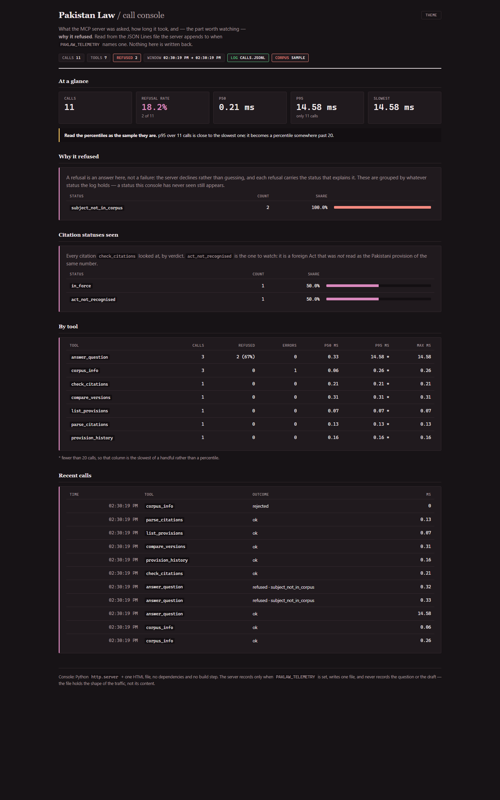

# observability

A call console for the MCP server: what it was asked, how long it took, and **why it
refused**.

Zero dependencies, like the rest of the package — `http.server`, one HTML file, a JSON
Lines log. No Prometheus, no Grafana, no database, no build step.



*Real traffic: 11 calls, an 18.2% refusal rate, and the statuses behind it.*

```bash
# 1. run the server with recording on. Off unless this names a file.
PAKLAW_TELEMETRY=calls.jsonl paklaw-mcp

# 2. in another terminal, read what it wrote
python observability/serve.py calls.jsonl
```

## Off unless you ask

`PAKLAW_TELEMETRY` unset means **no file is created and nothing is written**, anywhere.
That is not a default chosen for tidiness: `dependencies = zero` is on the badge and a
server that starts logging the moment it is installed is a different promise. Set the
variable and exactly one file is written — the one you named. Deleting it is a complete
uninstall.

## What is in the file

One JSON object per line, appended:

```json
{"at": 1760000000.12, "tool": "answer_question", "outcome": "refused", "ms": 1.88,
 "refused": true, "refusal_status": "subject_not_in_corpus"}
```

**Not in the file: the question, the draft, or any argument.** A question put to a legal
corpus is a person's question, and a draft pasted into `check_citations` is their draft.
What is recorded is the shape of the traffic — which tool, how long, what verdict — and
`tests/test_telemetry.py` asserts that a question and a draft put through the server do
not appear in the log it produced.

Five outcomes: `ok`, `refused`, `tool_error`, `internal_error`, `rejected` (an argument
the schema does not allow, which never reaches the handler).

The file rotates at 8 MB, keeping one generation, so a long-running server cannot fill a
disk.

## What the console shows

| panel | why it is there |
|---|---|
| **Why it refused** | the signature panel. A refusal is an answer here, not a failure, and the status says which kind |
| Citation statuses | every verdict `check_citations` reached, summed — `act_not_recognised` is the foreign Act that was *not* read as the Pakistani provision of the same number |
| At a glance | calls, refusal rate, p50/p95/slowest |
| By tool | calls, refusals, errors and latency per tool |
| Internal errors | by exception type, if any |
| Recent calls | the tail, with the refusal status |

Two things it refuses to pretend:

- **A percentile over a handful of calls is not a percentile.** Under 20 samples the page
  says so, in those words, beside the number.
- **Statuses are counted, never enumerated.** The groups come from whatever the log holds.
  A fixed list was written first, from a grep that found eleven statuses — the first real
  call produced `subject_not_in_corpus`, which was not among them.

## What it does not do

- It does not write to the log. It reads.
- It does not start the MCP server.
- It binds `127.0.0.1` only, and that is not configurable. A call log is a record of what
  somebody asked a legal corpus; the host for it is this machine.
- It computes nothing in the page. Every number comes from `collect.py`, which is pure
  functions over the events and is tested without a server.
